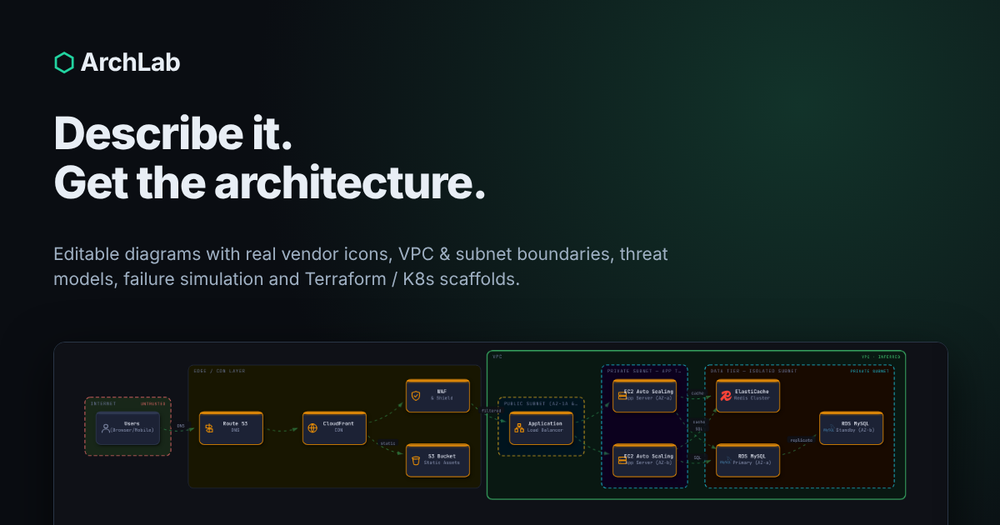

# ⬡ ArchLab — AI Architecture Diagram Generator

> **[arch.eknathalabs.com](https://arch.eknathalabs.com)** · Part of the [eknathalabs.com](https://eknathalabs.com) DevOps learning platform

Describe an architecture (or pick a template) and get an editable, animated diagram with real vendor icons, nested VPC / subnet / cluster boundaries, security and cost lenses, threat modelling, failure simulation and Terraform / Kubernetes / Compose scaffolds. Runs in one HTML file — no build step, no server. **Offline by default**: installable as an app, works with the network off, and makes no third-party requests. AI is opt-in (Claude with your own key, or a local model through Ollama).

## Features

**Generate**
- **AI mode** — Claude produces the diagram as JSON. Output is schema-validated and sanitised; on a malformed reply ArchLab retries once, then falls back to the offline parser. Pick Sonnet 5.5 (default), Opus 5.5, Haiku 5.5 or a custom model id.
- **Offline mode** — 29 templates plus a keyword parser; nothing leaves your browser.
- **Template browser** — searchable gallery with live thumbnails (press `T`).
- **Refine chat** — "add a cache after the API", "remove the CDN", "rename X to Y", "connect A to B". AI mode sends the current diagram to Claude; offline mode understands add / remove / rename / connect.

**Edit** (`E`)
- Drag nodes, connect, rename, duplicate, delete, add from a catalog with vendor icons; drop a node into a container to re-parent it. Full undo / redo, autosave to your browser.
- **Containers & boundaries** — groups nest (region → VPC → subnet / AZ / namespace) and are laid out as boundaries.
- Layout direction toggle (left→right / top→bottom) with animated morph.

**Understand**
- **Lenses** — Default, Security, Cost, Data, Blast, Latency; strokes and badges cross-fade in place.
- **Blast radius** — click a node and watch the impact ripple out hop by hop.
- **Failure simulation** — kill nodes or whole zones, run chaos mode, find single points of failure; shows degraded / down nodes and path availability.
- **Anti-patterns overlay** — heuristic checks (SPOF, exposed datastore, missing cache / queue / WAF, …).
- **Threat model** — STRIDE per component plus trust-boundary crossings; export as Markdown.
- **Explain this architecture** — typed narration (AI or offline) that walks the flow node by node.
- Step-by-step build, sequence view, minimap, DSL view.

**Build / Export** — every export carries an ArchLab watermark (see below)
- **IaC scaffolds** — Terraform (AWS / Azure / GCP), Kubernetes YAML, Docker Compose, Mermaid. Scaffolds are a starting point, not production-ready.
- SVG, PNG, PDF (print), design document (HTML / Markdown), DSL, project file (`.archlab.json`, re-openable).
- **Share link** — the whole diagram is compressed into the URL hash (`#s=`), nothing is uploaded.
- **Embed** — `?embed=1` read-only viewer with a "Made with ArchLab" badge; copy the iframe snippet from Export → Embed. `badge.svg` is included for READMEs.

**Polish** — animated edges and staggered node entrance, command palette (`Ctrl/⌘+K`), keyboard shortcuts (`?`), light / dark theme, minimap, `prefers-reduced-motion` respected, ARIA labels and visible focus rings.

**Offline & local (v3.1)**
- **Installable PWA** — `sw.js` caches the app on first visit; the header chip shows *Offline-ready*. Updates arrive through a "new version" bar, never silently.
- **Download a copy** — Export → *Download ArchLab* saves the whole app as one file; *with this diagram* embeds the current design so the file opens straight to it.
- **My library** — diagrams and up to 25 versions each, kept in your browser (IndexedDB). Rename, tag, search, restore, and **compare any version with the current diagram** (added / changed shown on the canvas).
- **Import** — Terraform (VPC/subnet nesting from references), docker-compose, Kubernetes YAML and Mermaid flowcharts (including `A & B` and subgraphs). Everything is parsed locally.
- **Export for other tools** — draw.io (`.drawio`) and Excalidraw (`.excalidraw`), both watermarked.
- **Cost estimate** and **compliance checklist** (PCI DSS v4, CIS v8, ISO 27001:2022, SOC 2 control families) — rough ranges and informational mappings, not a bill or an audit.
- **Present mode** (slides from the explanation, blast-radius slide, laser pointer) and **Quiz mode**.
- 12 architecture patterns with *use when / breaks when* notes, first-run tour, clickable lens counts, flow particles, inspector tabs, pinch / long-press on touch, print options (A3/A4/Letter/Tabloid, title block, legend), command-palette recents.
- **Local AI (optional)** — choose *Local model (Ollama)* in the AI box. Only `http://localhost:11434` / `127.0.0.1:11434` is allowed; start Ollama with `OLLAMA_ORIGINS` set to this site's origin.

**Motion & polish (v3.2)**
- **Build-up** — groups first, then components in dependency order with a small spring, then connections draw themselves. Repeat visits skip the long version.
- **Typewriter prompt** (Tab accepts the suggestion), a **progress sweep and check** on the Generate button, and a **ghost skeleton** while an AI model is thinking.
- **Direct manipulation** — magnetic connect (snaps to the nearest target), alignment guides with gap labels while dragging, settle on drop, nodes shrink out on delete and spring back on undo, hover trace of the full upstream / downstream path with faster particles.
- **Failure simulation** — damage ripples hop by hop, dropped traffic scatters at the break, recovery heals in a green wave, and a timeline scrubber (with play) steps through the failure.
- **Analysis** — radial lens wipe, rolling lens counts, pulsing severe findings, cost bars and total that count up, a clickable compliance ring that filters the checklist.
- **Shell** — context bar with a real saved-state dot, progressive toolbar, panels that nudge the canvas, compact / comfortable density, a View-Transition theme reveal, an offline chip that shows a plug when the network drops, and a watermark stamp on every export.
- **Touch** — panels become draggable bottom sheets with snap points, one-time pinch / long-press hint, light haptics where the browser supports them.
- **Sound** is off by default (palette → *Toggle sound effects*). All motion uses shared timing tokens and turns off with *Reduce motion* or the system setting.

## Watermarks

Everything that leaves the app carries a visible "ArchLab · arch.eknathalabs.com" mark: SVG, PNG, PDF/print (tiled), design doc, DSL, project files and every IaC scaffold. A watermark is a deterrent and attribution, not protection — it cannot stop screenshots.

## Privacy & security

- No analytics, no visitor counter, no fonts or scripts from other sites. In the default build the only places the page may connect are itself, `api.anthropic.com` (only when you choose Claude AI) and your own Ollama on localhost.
- **Strict build:** `ARCHLAB_OFFLINE_ONLY=1 python3 build/build.py` sets `connect-src 'self'` and hides the AI button entirely.
- Your API key lives in `sessionStorage` (this tab only) unless you tick **Remember on this device**. It is sent only to `api.anthropic.com`.
- The CSP still needs `'unsafe-inline'` for scripts because the app uses inline handlers.
- AI output, imports and share-link payloads are validated and sanitised (markup stripped, colours whitelisted, reserved ids rejected, unknown edges dropped) before rendering.
- The service worker only handles same-origin requests and never touches cross-origin traffic. The privacy button in the header lists everything stored.

## Keyboard shortcuts

Press `?` in the app for the full list. Highlights: `Ctrl/⌘+K` command palette · `T` templates · `E` edit · `C` connect · `B` blast · `S` simulate · `X` explain · `A` anti-patterns · `I` IaC · `R` refine chat · `L` cycle lens · `M` minimap · `Ctrl+Z / Y` undo / redo · `Ctrl+S` save project · `Ctrl+P` print / PDF · `Ctrl+wheel` zoom · `Esc` close.

## Getting started

Use the hosted site, or open `index.html` locally. To self-host, serve the folder from any static host (GitHub Pages with the included `CNAME`, Netlify, S3…).

**Deploy these files together** (the service worker and manifest are separate files): `index.html`, `sw.js`, `manifest.webmanifest`, `icon-192.png`, `icon-512.png`, `icon-maskable-512.png`, `og-image.png`, `badge.svg`. The service worker registers only over http(s); opened from `file://` the app still works, it just isn't installable.

For AI mode paste an Anthropic key from [console.anthropic.com](https://console.anthropic.com) into the AI box. Offline mode needs nothing.

## Icons & licensing

Brand marks are the [Simple Icons](https://simpleicons.org) set (CC0 1.0), 65 brands embedded as SVG paths. AWS, Azure, Slack and similar brands that Simple Icons does not carry use original generic glyphs tinted in the vendor colour. Product names and logos remain the property of their owners and are used only to identify the technology. ArchLab itself is MIT-licensed.

## Tech stack

Vanilla HTML / CSS / JS, inline SVG. No framework, no bundler, no runtime dependencies. Share links use the browser's `CompressionStream`. Fonts: Syne, JetBrains Mono.

## Changelog

### v3.2 (current)
- Motion system (tokens, reduced-motion), build-up choreography, typewriter prompt, generate progress + skeleton
- Magnetic connect, alignment guides, hover path trace, delete / undo animation
- Cascading failure with heal and timeline scrubber; lens wipe; risk pulse; animated cost bars; compliance ring
- Context bar, progressive toolbar, density toggle, theme reveal, stamp on export, offline plug chip
- Bottom sheets, gesture hint, haptics, optional sound

### v3.1
- Offline-first: PWA + service worker, no third-party requests, analytics and visitor counter removed, strict `OFFLINE_ONLY` build
- Library with versions and diff; importers (Terraform, Compose, K8s, Mermaid); draw.io and Excalidraw export
- Cost estimate, compliance checklist, present mode, quiz mode, 12 patterns, tour, print options, touch gestures
- Optional local AI via Ollama; downloadable self-contained copy
- Fixes found in testing: print options were not applied, library search had no handler, version-compare overlay was cleared immediately, `A & B` Mermaid shorthand now imports, generate button label kept its provider text

### v3.0
- Animated edges, staggered node entrance, cross-fading lenses, blast-radius ripple, layout morphing
- Editable canvas with undo / redo and autosave; containers and nested boundaries; real vendor icons
- IaC scaffolds, failure simulation, refine chat, explain-this-architecture, anti-pattern overlay, threat model
- Template browser, command palette, redesigned toolbar menus, theme polish, minimap polish
- Share links, embed mode + badge, project files; watermark on every export
- Model picker, AI output validation with retry and offline fallback, sanitised rendering, session-scoped key, CSP
- Privacy-respecting optional analytics; OG / Twitter / canonical meta; accessibility pass; mobile header fix

### v2.x
- AI mode, offline mode, dark / light theme, mobile drawer, step-by-step build, blast radius, node expand, sequence view, minimap, Azure / GCP / Kubernetes templates

## Related tools — eknathalabs.com

K8s Lab, CI/CD Lab, ChaosLab, Docker Lab, Linux Lab, Blog and Learn live at `*.eknathalabs.com`.

## License

MIT — see `LICENSE`.

Built by <a href="https://eknathalabs.com">Eknatha Reddy Puli</a> · <a href="https://github.com/eknatha">@eknatha</a>

